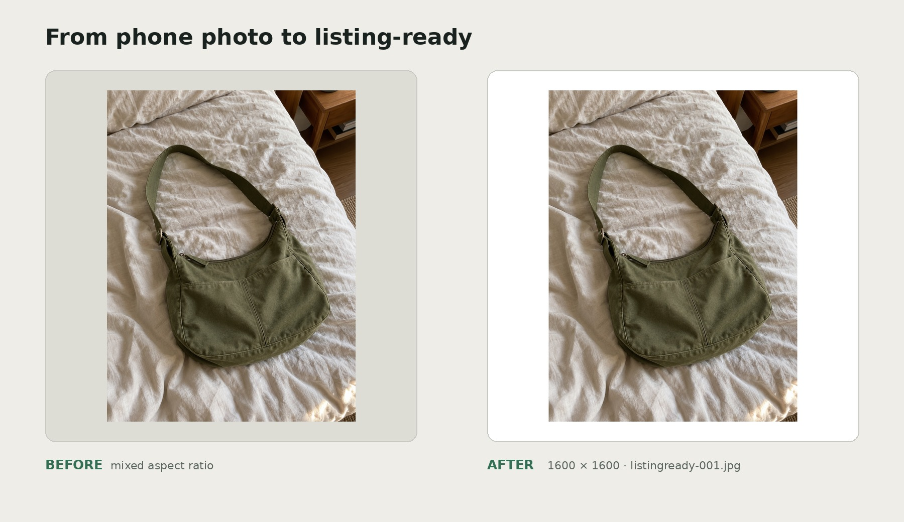

# ListingReady

ListingReady is for small shops and second-hand sellers with a folder of mismatched phone photos.
Drop in JPG or PNG files, pick a canvas, and download a consistently named square-image package.
It runs locally and only rotates, scales, and pads your photos—there is no cropping, background removal, or AI processing.



## Install

You need Python 3.10 or newer.

```bash
git clone https://github.com/cxing4307-afk/listingready.git
cd listingready
python3 -m venv .venv
source .venv/bin/activate
python -m pip install -e .
```

## Use it

Start the local server:

```bash
python run.py
```

Open `http://127.0.0.1:5000`, then:

1. Drop up to 100 JPG or PNG photos into the page.
2. Enter a prefix such as `oakstreet` and choose white or light gray.
3. Click **Build my ZIP**.

The archive contains `oakstreet-001.jpg`, `oakstreet-002.jpg`, and so on. Every output is a 1600 × 1600 JPEG at quality 92. If one file cannot be read, the usable images still export and `_skipped.txt` explains what was left out.

## What it does to a photo

ListingReady applies the source file's EXIF orientation, scales the complete image proportionally, and centers it on the selected square canvas. Transparent PNG pixels are composited onto that canvas. It does not crop, stretch, retouch, remove a background, or call an external service.

## Run the tests

```bash
python -m pip install -e '.[dev]'
pytest
```

## Known issues

- A batch is processed in memory by a local development server, so 100 large photos can use noticeable RAM; the app is not intended as a public upload service.
- Animated images are not supported as animations; only the first frame is used.
- There is no drag-to-reorder or remove-one-file control after a drop. Reopen the picker to correct the list.

## Dependency licenses

All direct dependencies use permissive licenses:

| Dependency | Used for | License |
| --- | --- | --- |
| Flask | Local web interface | BSD-3-Clause |
| Pillow | EXIF correction and image rendering | MIT-CMU (HPND-style) |
| pytest | Development tests | MIT |
| setuptools | Package build backend | MIT |
| Werkzeug | Flask HTTP utilities | BSD-3-Clause |
| Jinja2 | HTML templates | BSD-3-Clause |
| MarkupSafe | Safe template strings | BSD-3-Clause |
| ItsDangerous | Flask signing utilities | BSD-3-Clause |
| Click | Flask command-line support | BSD-3-Clause |
| Blinker | Flask signals | MIT |
| iniconfig | pytest configuration | MIT |
| packaging | pytest version handling | Apache-2.0 OR BSD-2-Clause |
| pluggy | pytest plugins | MIT |
| Pygments | pytest terminal highlighting | BSD-2-Clause |
| colorama | pytest colors on Windows | BSD-3-Clause |

The first two rows are runtime dependencies. pytest and its supporting packages are only needed for development; setuptools is only needed to build the package. All licenses above are permissive.

## License

ListingReady is available under the [MIT License](LICENSE).
